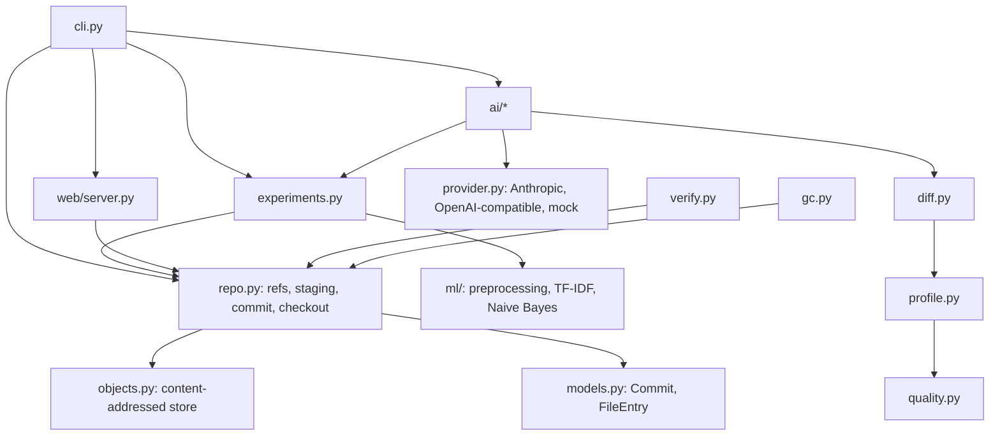

# Architecture



Dependencies point downwards only. `ai/` imports the core; the core never imports `ai/`. Runtime has no third-party dependencies.

## On-disk layout

```
.datavault/
  format              repository format version
  config.json
  index.json          staged raw files (path -> sha256, size)
  HEAD                "ref: <branch>" or "commit: <id>"
  objects/ab/cdef...  file contents, named by SHA-256
  commits/<id>.json   immutable manifests
  refs/heads/<name>   branch tips
  refs/tags/<name>    immutable tags
  experiments/<id>.json
  ai/                 saved AI analyses and proposed tests
  tmp/                staging area for atomic writes
  lock                flock target
```

## Identity

- Object id: SHA-256 of the file bytes. Hashing streams in 1 MiB chunks, and the bytes that are hashed are the bytes that are stored (the file is copied and hashed in one pass, so there is no gap between hashing and storing).
- `content_id`: SHA-256 of the canonical JSON of `files`, `sources` and `preprocessing`. It excludes parents, message, author, timestamp and annotations, so identical data with identical preprocessing has the same content id on any machine at any time.
- Commit id: SHA-256 of the canonical JSON of the whole manifest, including parents and timestamp. It changes the history, not the data.

Canonical JSON means sorted keys, no whitespace, UTF-8, NaN rejected.

## Commit publication order

Everything below runs under an exclusive `flock` on `.datavault/lock`.

1. Re-read HEAD and the branch tip.
2. Re-hash every staged object and compare with the index.
3. Apply preprocessing; write derived objects (temp file, fsync, rename, fsync directory).
4. Run quality checks if requested. Errors abort before anything is published.
5. Write `commits/<id>.json` atomically.
6. Move the branch ref atomically. This is the publication point.

A crash before step 6 leaves at most an unreferenced commit file and some objects. `verify` does not treat that as an error, and `gc` removes it. A crash cannot leave a branch pointing at a partial commit because refs are only updated after the manifest exists in full.

## Experiments

An experiment record is a content-hashed JSON file containing the dataset commit and content id, the normalised configuration and its hash, environment (Python, platform, Git revision and dirty flag, lockfile hash), metrics, artifact references (model and metrics objects in the object store), logs, status and optional parent experiment. Failed runs are recorded with the error.

Reproduction reruns training from the recorded dataset commit and configuration and reports four separate facts: same dataset content, same configuration, same metrics, same model artifact bytes. It also lists environment differences. Bit-identical model artifacts are checked, not assumed; the tests only demonstrate this on one machine and Python version.

## AI boundary

`ai/` receives deterministic facts, never raw datasets. The flow is: diff or experiment comparison, then `evidence.py` turns it into numbered facts (sanitised and redacted), then the provider is called with a fixed system prompt and the facts as JSON lines inside an `<evidence>` block, then `schemas.py` validates the reply and marks each claim `grounded`, `hypothesis` or `unsupported`, then the result and its raw response are saved under `.datavault/ai/`. Nothing in `ai/` writes to `commits/`, `objects/`, `refs/` or `experiments/`.

## Dashboard

`web/server.py` is a read-only `http.server` that exposes JSON endpoints built from the same functions the CLI uses. The page is plain JavaScript plus D3 (loaded from cdnjs). It cannot trigger AI calls or write anything, so API keys never reach the browser.
